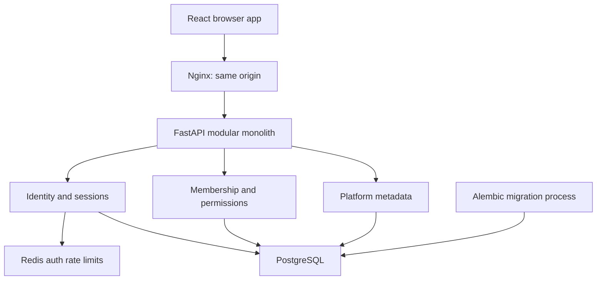
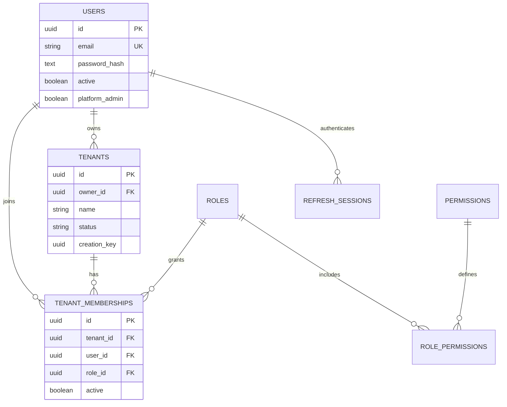
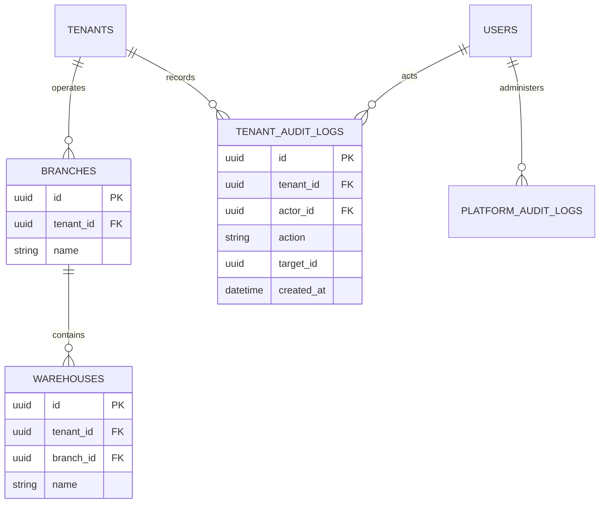
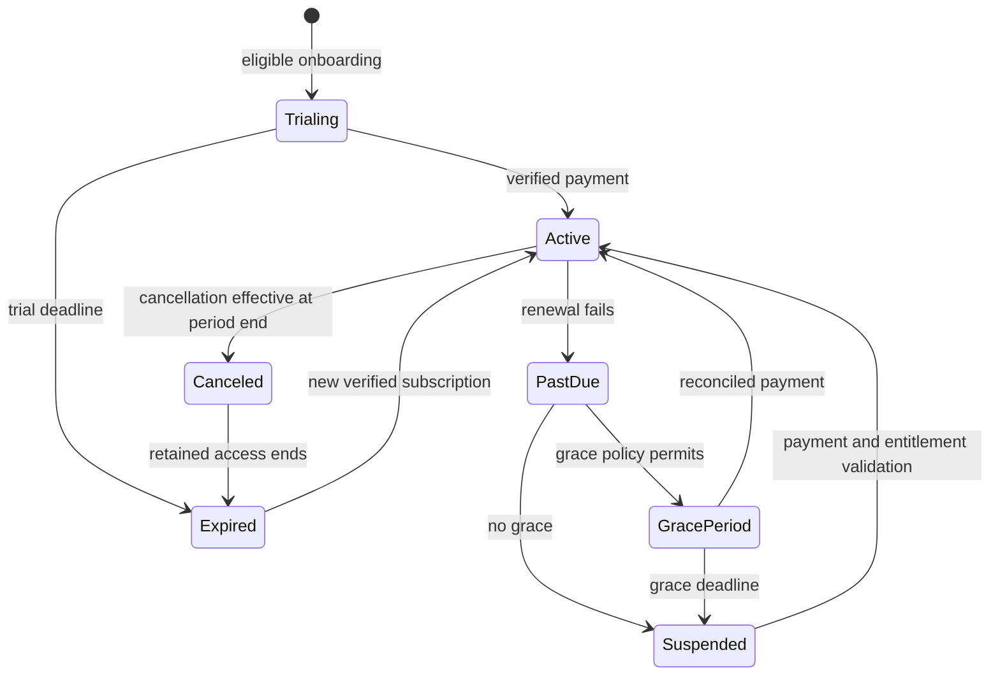

# SmartRetail Cloud architecture

## 1. Decisions

| Area | Decision and consequence |
|---|---|
| Architecture | Modular monolith with auth, tenancy and platform modules. Billing is implemented with durable operations and Celery reconciliation; future retail modules share ACID transactions initially. Avoid distributed transactions in the first release. |
| Backend | Python 3.12, FastAPI, synchronous SQLAlchemy sessions with psycopg. Blocking database work runs in synchronous endpoint/dependency workers. One session/transaction per request. |
| Database | PostgreSQL, UUID keys, explicit composite tenant foreign keys, Alembic revisions. Runtime role cannot bypass RLS; startup rejects superuser/BYPASSRLS connections. |
| Tenant model | Tenant is the business identity in Milestone 1. Avoid a second identical Business row; a business-profile table will hold tax/legal configuration when needed. |
| Authorization | Identity from validated JWT and a live session; membership from the database; tenant header only selects a candidate. Permission lookup is server-side and not trusted from JWT/client role claims. |
| Isolation | Explicit tenant predicates in repositories plus forced PostgreSQL RLS on tenant-owned operational tables. Control-plane metadata and global identities are not tenant-scoped tables. |
| Session transport | Short-lived bearer access token in React memory; seven-day HttpOnly refresh cookie, rotation and family reuse revocation. No tokens in localStorage. Cookie endpoints require an exact Origin. |
| UI | React/TypeScript, TanStack Query, React Hook Form/Zod, Tailwind, shadcn-style Button using Radix Slot/CVA. Real API data; no fabricated sales dashboard. |
| Platform administration | Global tenant metadata and suspend/reactivate only. Platform admin is not a tenant permission. No support impersonation endpoint exists. |
| Deployment | Compose for development; separate migration process; reverse proxy and same-origin UI/API. CI builds frontend/backend and runs database tests. |
| Future database routing | Resolve a verified TenantContext first, then introduce a connection resolver behind repositories. A dedicated database will still use tenant predicates; cross-tenant reporting stays in control plane. Routing is a future seam, not implemented support. |

## 2. System diagram

Future Celery/outbox workers and object storage are not running services in this milestone. Add them when there is an implemented job or storage use case; do not expose fake health indicators.

## 3. Implemented database ER diagrams

The warehouse relationship is **composite** `(tenant_id, branch_id) → branches(tenant_id, id)`, not merely a branch UUID reference. RLS alone does not guarantee tenant consistency of relationships.

| Table | Important constraints/indexes |
|---|---|
| users | UUID PK; unique normalized lowercase email; no public API to promote platform admin |
| tenants | UUID PK; unique `(owner_id, creation_key)` for retry-safe creation; active/suspended check |
| tenant_memberships | Unique `(tenant_id,user_id)`; tenant and user indexes; role/user/tenant FKs |
| roles / permissions | Unique role name/permission code; global immutable RBAC catalog in this milestone |
| role_permissions | Composite primary key `(role_id,permission_id)` |
| branches | Unique `(tenant_id,name)` and `(tenant_id,id)` |
| warehouses | Composite tenant/branch FK; unique `(tenant_id,branch_id,name)` |
| refresh_sessions | User/family indexes; timezone-aware expiry; consumed and revoked flags; signed token contains session UUID, not a stored plaintext refresh credential |
| tenant_audit_logs | Tenant index; runtime role gets SELECT/INSERT, no UPDATE/DELETE |
| platform_audit_logs | Runtime gets SELECT/INSERT; metadata mutation audit recorded in the same transaction |

### Later domain schema (designed, not migrated)

| Domain | Tables and relationships |
|---|---|
| Billing | subscription_plans → plan_features; tenants → subscriptions → subscription_items / subscription_invoices → subscription_payments; payment_provider_events with unique `(provider,event_id)`; tenant_feature_overrides; tenant_usage |
| Catalog | products → product_variants → product_prices; category/brand FKs; tenant-scoped SKU/barcode uniqueness |
| Stock | inventory_balances unique `(tenant_id,warehouse_id,variant_id)`; inventory_movements immutable ledger; stock_reservations with expiry and idempotency key |
| Procurement | suppliers → purchase_orders → purchase_order_items; goods_receipts and goods_receipt_items referenced by stock movement |
| Sales | register_sessions → sales → sale_items; payments; refunds and refund_items; immutable issued invoices; expenses |
| Customers | customers; loyalty/store-credit append-only ledgers; price groups and customer price overrides |

All tenant-owned records carry `tenant_id`; every operational FK uses `(tenant_id,id)` where both sides are tenant-owned. Global product definitions are not shared across unrelated tenants. Money uses `NUMERIC(19,4)` internally, ISO currency codes and explicit currency-specific rounding at invoice boundaries. Quantity uses `NUMERIC(18,3)` if weighted sales are supported. Never use floats for money. These financial types are planned; the foundation contains no money columns.

Use immutable invoices, refund/credit events and stock ledgers rather than editing financial history. Soft deletion/archival applies to products/customers after retention decisions; membership revocation is an active flag. No hard-delete business API is implemented. Future migrations are explicit immutable Alembic revisions using expand/backfill/contract; `schema_v1.py` is frozen specifically to prevent later model changes rewriting the initial migration.

## 4. Isolation and transaction strategy

1. Validate JWT signature, issuer, audience, type and expiry. Confirm user active and refresh family session not revoked.
2. Set `app.user_id` using transaction-local PostgreSQL `set_config(..., true)`.
3. Look up the selected UUID's active membership, constrained to the authenticated user. Membership's RLS permits only that user's memberships until tenant context is established.
4. Reject missing membership or suspended tenant. Set `app.tenant_id` only after authorization.
5. Resolve required permission from the database role catalog on each operation.
6. Repository predicates scope queries to the selected tenant. RLS separately checks reads and writes; missing context yields no tenant rows.
7. Commit/rollback the request transaction; local settings expire on both paths, preventing pooled connection context leaks.

Onboarding locks the actor/idempotency-key combination with a transaction-level PostgreSQL advisory lock. Tenant, owner membership, main branch and audit entry are committed together. Same key/same body returns the original tenant; different body returns 409. The database unique constraint is a second safeguard.

Refresh rotation serializes by user, consumes the old refresh session and issues the new session in one transaction. Reuse revokes the whole family and returns 401 **without raising a transaction-rolling-back exception**. Logout revokes all user sessions. Access checks consult revocation state. Expired session cleanup is a future maintenance task.

The RLS design protects against an omitted tenant predicate. It is not a boundary against arbitrary SQL execution using compromised backend credentials: that service can set tenant context and access identity/control-plane tables. Prevent SQL injection with parameterized queries; keep migration credentials out of the API. Superusers/BYPASSRLS always bypass RLS. Table owners normally bypass unless FORCE RLS is enabled. No claim of protection against a compromised database administrator is made.

Future cache keys must begin with tenant identity (and user/permission version where appropriate); jobs must carry tenant ID plus actor/service scope and re-establish authorization. Future object keys use `tenants/{tenant_uuid}/...` with authorization before signed URLs. These facilities are requirements for later modules, not unused stubs here.

## 5. Subscription state machine (Milestone 2 design)

Cancellation requested mid-period is a `cancel_at_period_end` flag, not immediate state transition. Scheduled downgrades take effect next cycle; exceeding the new quota blocks new resource creation while retaining records and export access. Financial eligibility and platform abuse suspension are separate concepts; billing must never silently reactivate an administratively suspended tenant.

Provider adapter will expose create-checkout, fetch-subscription, verify-webhook, cancel, and reconcile operations. A provider selection for India must be verified against actual recurring payment methods and merchant eligibility at implementation time. No provider is integrated in Milestone 1. Verify webhook signatures over raw bytes before storing a unique provider/event record. Handle retries idempotently in one transaction; reconcile stale/out-of-order events against provider state. A frontend success redirect never grants paid access. Tenant quotas and prices are authoritative backend data.

## 6. Planned POS transaction

Validate active entitlement and cashier permission; lock inventory balances in stable SKU order; compare idempotency payload hash; calculate price, tax and discount server-side; verify authorized payment state; create sale, lines, payment records and stock movements in one transaction. Commit before rendering the immutable receipt. Reject insufficient stock with no partial deduction. External authorization/capture cannot join the database transaction: use pending sale/reservation plus reconciliation/outbox workflow, not a false ACID claim spanning a payment gateway. Concurrent checkout and duplicate webhook tests belong to the milestones that implement these operations.

## Reference basis

- PostgreSQL RLS: https://www.postgresql.org/docs/17/ddl-rowsecurity.html
- SQLAlchemy session transactions: https://docs.sqlalchemy.org/en/20/orm/session_basics.html

The selected defaults are architecture decisions for this project, not a claim that all commercial requirements are already implemented.

## Milestone 2 billing

See [the billing implementation guide](MILESTONE_2.md) for the provider boundary, durable operation flow, invoice isolation, entitlement enforcement and production setup.
