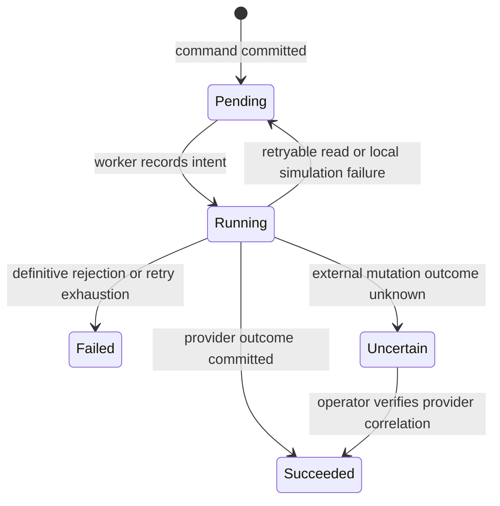

# Milestone 2 — Subscription engine

This release adds working subscription billing to the existing tenant foundation. The default provider is a **local sandbox that collects no money**. Razorpay integration code is included, but merchant credentials, provider plan mappings, HTTPS webhook delivery and account-specific acceptance testing are required before real billing.

## Implemented

| Capability | Behavior |
|---|---|
| Plan catalog | Starter, Growth, Business and Enterprise; monthly/yearly INR prices; backend-controlled quotas and features. Initial prices are sample product configuration, not an approved commercial price list. Enterprise is contact-only. |
| Trials | New workspaces get one configurable trial (14 days by default). The migration gives existing workspaces a 14-day trial once. No endpoint resets a trial. |
| Entitlements | Branch/user quotas checked under a subscription row lock before insert. Warehouse creation requires the plan feature. Expiry blocks new business records while existing read access and billing remain available. |
| Checkout | Idempotent HTTP command returns a durable operation. A background worker creates the provider subscription; Razorpay returns a hosted payment URL. The browser cannot activate a paid plan. |
| Payments | Only provider-fetched captured payments linked to paid invoices establish paid periods. Amount, currency and period must match the current catalog/provider plan. Authorizations alone grant no access. |
| Webhooks | HMAC-SHA256 over raw bytes; current/previous Razorpay secrets; event-ID and body-hash deduplication; bounded payload and replay window. Receipt queues authoritative reconciliation rather than trusting event order. |
| Plan changes | Upgrades and downgrades are scheduled at cycle end. No immediate prorating. Entitlements change when the new plan's payment period is verified. |
| Downgrades | Existing data retained. Over-limit resources remain readable; creation of that resource is blocked until usage is reduced or the plan is upgraded. |
| Cancellation | Ends recurring billing at the paid period boundary. A not-yet-paid checkout may be canceled immediately. No deletion of tenant data. |
| Payment failures | Provider handles charge retries. Application reconciles provider outcomes with bounded exponential retries and a configurable grace period. There is no app endpoint that retries a charge blindly. |
| Invoices/history | Tenant-scoped captured-payment history, printable application receipts and provider references. Sandbox receipts are explicitly marked. This is not GST tax-invoice generation. |
| Notifications | Deduplicated in-app trial-ending, trial-expired and renewal notices. Email/SMS delivery is not implemented. |
| Operator controls | SaaS MRR/ARR (sandbox excluded), status counts, failed/uncertain operations, plan creation API, provider mapping UI/API and audited uncertain-operation recovery. Retail sales are not mixed into SaaS metrics. |

## Local setup and upgrade

Preserve your existing `.env` and database volume. From the project root:

```bash
python3 scripts/setup_env.py
docker compose up --build -d
docker compose ps -a
```

The `migrate` service applies Alembic `0002`. The worker processes durable operations, and the scheduler wakes it every 30 seconds. Periodic provider reconciliation has one request key per tenant per five-minute window. New invoice rows are immutable and deduplicated.

No payment keys are required for the default sandbox. Sign in as a business owner, choose **Subscription**, select Growth or Business, wait for checkout to finish, then choose **Simulate successful payment**. Inspect the new limits and payment receipt. The sandbox intentionally refuses another charge while the current period is still paid; automated tests advance period boundaries to test renewals.

Watch operations in the UI or inspect service logs:

```bash
docker compose logs --tail=100 migrate worker scheduler api
```

A manual one-shot worker pass is available for development:

```bash
docker compose exec api python -m app.billing.worker
```

Existing test accounts can still be created with `DEMO_PASSWORD` and `python -m app.seed`. Do not remove volumes to fix a billing or migration error.

## Razorpay configuration

1. Use Razorpay Test Mode first. Create monthly and yearly provider plans that exactly match the backend catalog amount, currency and interval. Amounts are integer paise: Starter is 49,900 monthly / 499,000 yearly; Growth 149,900 / 1,499,000; Business 399,900 / 3,999,000. Change your catalog via a new plan version before offering different prices.
2. Sign in as the platform operator and map `plan_...` IDs under Platform → Razorpay plan mapping. Plan mappings are immutable after assignment. The checkout worker fetches the provider plan and rejects a mismatch before creating a subscription.
3. Set private environment values:

```dotenv
BILLING_PROVIDER=razorpay
RAZORPAY_KEY_ID=<your-test-key-id>
RAZORPAY_KEY_SECRET=<your-test-key-secret>
RAZORPAY_WEBHOOK_SECRET=<your-webhook-signing-secret>
```

4. Expose an HTTPS webhook endpoint: `POST /api/v1/billing/webhooks/razorpay`. Enable subscription events (charged, activated, pending, halted, cancelled, completed and relevant updates). A missed event is also picked up by periodic reconciliation.
5. Restart API, worker and scheduler after configuration changes. Do not point an existing active sandbox subscription at live billing: use separate databases/environments and real subscriptions. Production settings prohibit the sandbox; sandbox entitlements imported accidentally into production cannot authorize writes.
6. Exercise hosted checkout, captured payment, renewal failure/recovery, scheduled change, cancellation and duplicate deliveries using your merchant account. The connector code alone is not evidence that Razorpay has enabled Subscriptions or any particular payment method for the account. Available card/UPI/mandate options depend on provider eligibility and account configuration.
7. Before live use, use live keys/mappings in an isolated production configuration with `ENVIRONMENT=production`, `SECURE_COOKIES=true`, an exact HTTPS `WEB_ORIGIN`, backups and reviewed pricing/tax handling.

The adapter requests 120 monthly or 10 yearly cycles. These subscriptions have a finite ten-year horizon, after which a new agreement is needed. It requests provider customer notifications. Credentials and full provider payloads are never returned to the frontend.

## Reliability and ambiguous outcomes



The operation row is committed as `running` before an external mutation. A timeout or process interruption must never trigger a second subscription creation. Such operations become `uncertain` and block further billing changes. Creation includes `tenant_id` and `operation_id` in provider notes, allowing an operator to locate the exact subscription. Do not substitute an arbitrary provider ID.

An operator can reconcile an uncertain operation through:

```http
POST /api/v1/platform/billing/tenants/{tenant_id}/operations/{operation_id}/recover
Authorization: Bearer <platform-admin-token>
Content-Type: application/json

{"provider_ref":"sub_..."}
```

Recovery verifies provider state and operation correlation. Scheduled plan recovery requires the expected provider plan. Cancellation recovery waits for provider-confirmed cancellation/completion; a merely requested cancellation is not assumed successful. Unknown outcomes are not force-marked successful. Record the provider investigation before any manual financial intervention.

Webhook event IDs are not part of Razorpay's signed body, so body hashes are deduplicated too. Old events outside seven days are rejected; use reconciliation for older missed events. Unknown subscriptions return 503 so delivery retries after the creation operation links the subscription. Historical events for a previous provider subscription are recorded without changing the current subscription.

## Data and security boundaries

`subscriptions`, `billing_operations`, `subscription_invoices` and `billing_notices` use forced tenant RLS. Global provider routing/event tables contain billing control-plane metadata, not shop sales or card details. Subscription endpoints verify active membership plus owner billing permission. Platform billing controls do not grant retail-data access. A paid renewal never reactivates an administratively suspended tenant.

Catalog versions are immutable for pricing changes: create a new code rather than changing an existing contract's provider mapping. Pricing is validated against Razorpay before checkout/change. Webhook handlers do no provider networking and have a 256 KiB input limit. The worker uses per-tenant advisory locking; resource creation uses the subscription row lock to prevent concurrent quota overshoot.

`subscription_invoices` stores one captured subscription payment per invoice; the provider subscription model does not use POS split payments. Issued application receipts are not statutory invoices and do not implement GST/e-invoicing, credit notes or a full refund ledger. The adapter stops access when the current provider payment is reported refunded. Tax/accounting workflows belong in a separate reviewed release.

## Verification

```bash
python3 scripts/test_setup_env.py
docker compose --profile test run --rm tests
```

CI additionally starts the actual API, worker, scheduler and Nginx and runs `backend/scripts/smoke_billing.py` against a disposable sandbox database. This creates a disposable account/tenant, performs checkout, waits for Celery, simulates payment and checks the invoice. Never run that smoke script against a live merchant configuration.

See `TEST_STATUS.md` for the actual results. Razorpay requests are covered with HTTP mock contract tests; no merchant test/live transaction has been performed without your credentials.

## Reference documentation

- [Razorpay subscription APIs](https://github.com/razorpay/markdown-docs/blob/master/api/payments/subscriptions.md)
- [Create/update/cancel subscription parameters](https://github.com/razorpay/markdown-docs/blob/master/api/payments/subscriptions-custom.md)
- [Raw-body signatures and duplicate event IDs](https://github.com/razorpay/markdown-docs/blob/master/webhooks/validate-test.md)
- [Invoice fields and payment references](https://github.com/razorpay/razorpay-node/blob/master/documents/invoice.md)
